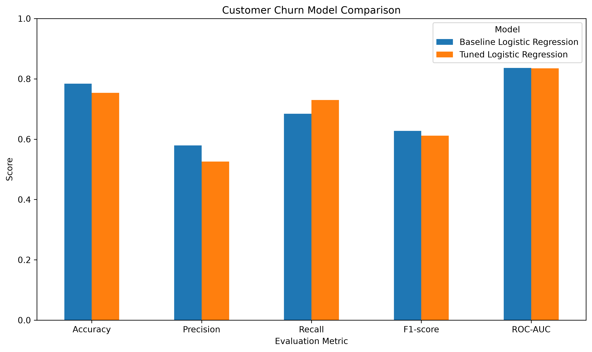
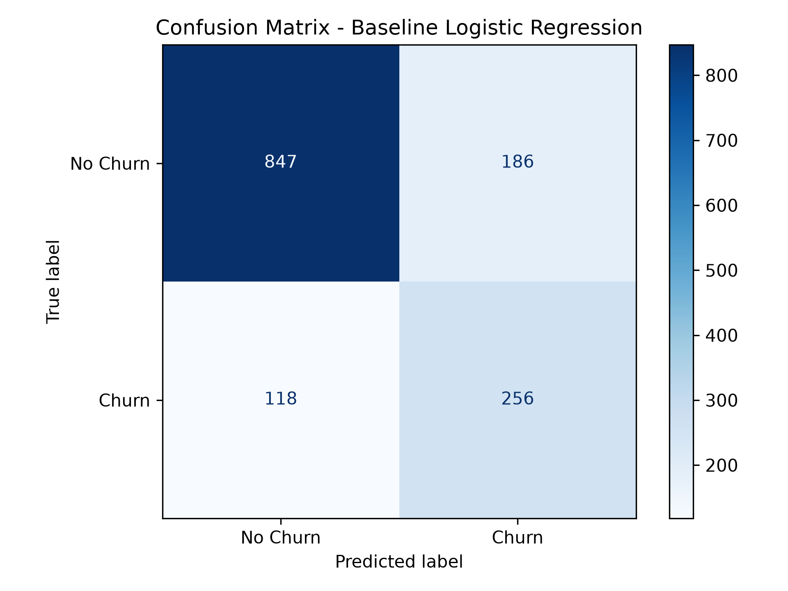
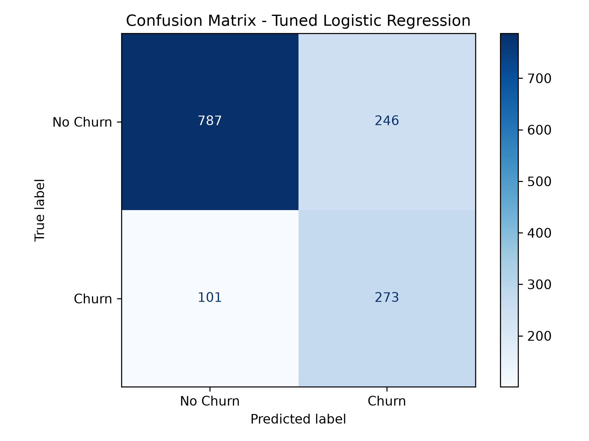
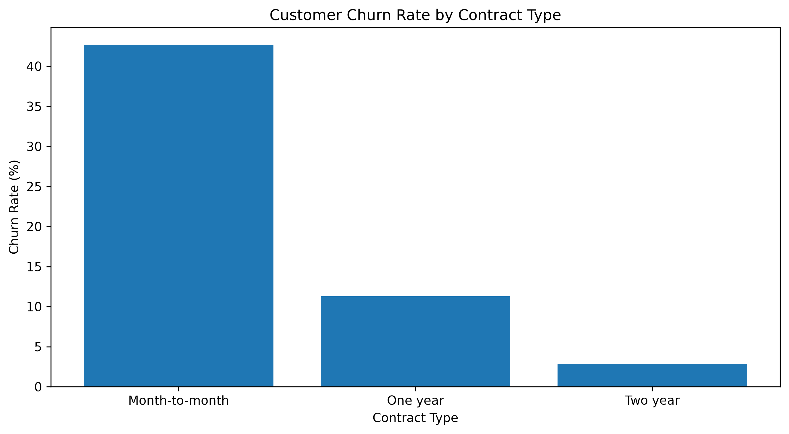
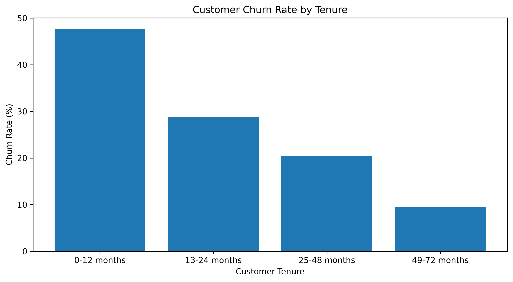

# Customer Churn Prediction & Retention Insights System

A machine learning portfolio project that predicts customer churn risk and explores customer-retention insights using the IBM Telco Customer Churn dataset.

## Project Overview

Customer churn occurs when customers stop using a company's services. This project uses machine learning to estimate churn probability and supports data-driven retention planning.

The application allows users to enter customer details, view estimated churn probability, classify customers as high or low risk, and explore model explanations and suggested retention actions.

## Key Features

- Customer churn probability prediction
- Interactive Streamlit application
- Logistic Regression classification pipeline
- Feature preprocessing with imputation, scaling, and one-hot encoding
- Decision-threshold selection
- Baseline and tuned model comparison
- Feature coefficient visualization
- Contract-based and tenure-based churn analysis
- Suggested customer-retention actions
- CSV reports and visualizations

## Technology Stack

- Python
- Pandas
- Scikit-learn
- Streamlit
- Matplotlib
- Joblib

## Dataset

The project uses the Telco Customer Churn dataset, containing customer characteristics, service subscriptions, contract details, charges, tenure, and churn status.

After removing the customer identifier and rows with missing `TotalCharges`, the analyzed dataset contains **7,032 customers**.

- Churned customers: 1,869
- Retained customers: 5,163
- Overall churn rate: 26.58%

## Model Performance

Both models were evaluated on the same held-out test set of 1,407 customers.

| Metric | Baseline Logistic Regression | Tuned Logistic Regression |
|---|---:|---:|
| Decision threshold | 0.40 | 0.58 |
| Accuracy | 78.39% | 75.34% |
| Precision | 57.92% | 52.60% |
| Recall | 68.45% | 72.99% |
| F1-score | 62.75% | 61.14% |
| ROC-AUC | 83.59% | 83.51% |

The baseline model achieved the higher F1-score and accuracy. The tuned model achieved higher recall, identifying a larger proportion of actual churn cases at the cost of lower precision.

The baseline model is retained as the current application model. Model selection should also consider the business cost of missed churn cases and unnecessary retention offers.

## Model Comparison



### Confusion Matrices

**Baseline model**



**Tuned model**



## Business Insights

### 1. Contract Type

| Contract | Customers | Churn Rate |
|---|---:|---:|
| Month-to-month | 3,875 | 42.71% |
| One year | 1,472 | 11.28% |
| Two year | 1,685 | 2.85% |

Month-to-month customers have the highest observed churn rate. Businesses could investigate their service experience and offer suitable contract options without pressuring customers into longer commitments.



### 2. Customer Tenure

| Tenure Group | Customers | Churn Rate |
|---|---:|---:|
| 0–12 months | 2,175 | 47.68% |
| 13–24 months | 1,024 | 28.71% |
| 25–48 months | 1,594 | 20.39% |
| 49–72 months | 2,239 | 9.51% |

Customers in their first 12 months have the highest observed churn rate. Early onboarding, satisfaction check-ins, and timely support may be useful retention strategies to test.



These findings are associations in historical data and do not establish causation.

## Run Locally

### 1. Clone the repository

```bash
git clone https://github.com/YOUR-USERNAME/customer-churn-prediction.git
cd customer-churn-prediction
```

### 2. Create a virtual environment

```bash
python -m venv venv
```

Windows PowerShell:

```powershell
.\venv\Scripts\Activate.ps1
```

### 3. Install dependencies

```bash
pip install -r requirements.txt
```

### 4. Prepare the dataset and model

Ensure the dataset is available at:

`data/Telco-Customer-Churn.csv`

Ensure the trained model is available at:

`models/churn_model.joblib`

If either file is not included in the repository, obtain the dataset from its original source and run the model-training script to recreate the model.

### 5. Launch the application

```bash
streamlit run app.py
```

## Project Structure

```text
customer-churn-prediction/
├── app.py
├── requirements.txt
├── README.md
├── data/
│   └── Telco-Customer-Churn.csv
├── models/
│   ├── churn_model.joblib
│   └── churn_model_tuned.joblib
├── src/
│   ├── explore_data.py
│   ├── train.py
│   ├── compare_models.py
│   ├── tune_threshold.py
│   ├── save_model.py
│   ├── evaluate_model.py
│   ├── feature_importance.py
│   ├── improve_models.py
│   ├── compare_final_models.py
│   └── business_insights.py
└── reports/
    ├── final_model_comparison.csv
    ├── model_comparison.png
    ├── confusion_matrix_baseline.png
    ├── confusion_matrix_tuned.png
    ├── churn_by_contract.csv
    ├── churn_by_tenure.csv
    ├── churn_by_contract.png
    ├── churn_by_tenure.png
    └── business_insights_report.md
```

## Limitations

- Predictions are estimates, not guarantees of future customer behavior.
- The model is trained on historical data and may not generalize to other businesses or time periods.
- Feature coefficients represent model associations, not proof of causation.
- Retention suggestions are rule-based examples and their effectiveness has not been established by this project.
- Model performance should be monitored and reassessed before real-world business use.

## Future Improvements

- Evaluate model performance on newer customer data.
- Compare additional classification algorithms.
- Assess probability calibration and business-specific decision thresholds.
- Add a customer-segment dashboard and retention campaign evaluation.
- Improve automated testing and deployment.

## Author

**Maneesha Yapa**

Health Information & Communication Technology Undergraduate | Aspiring AI/ML Engineer

GitHub: https://github.com/maneeshayapa

---

